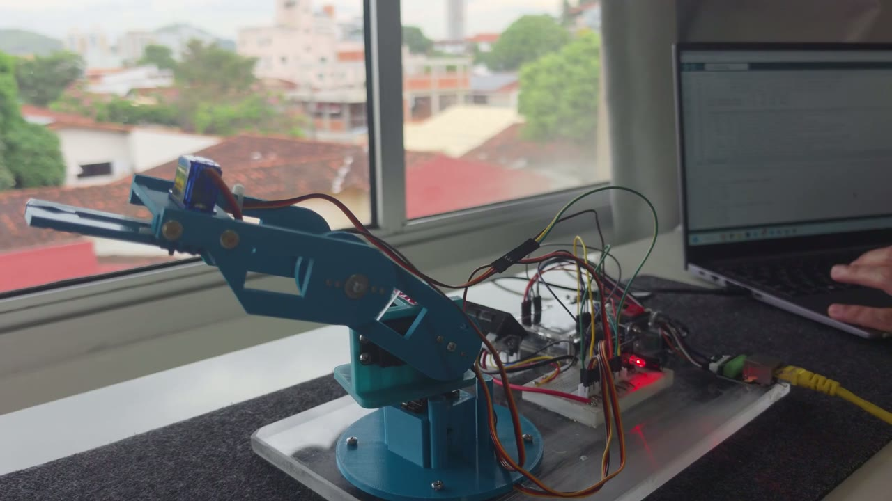

# Mídia do protótipo em funcionamento

Registro do braço montado e operando, feito em 20/11/2026.

[](braco_robotico_demo.mp4)

▶ **[Assistir ao vídeo](braco_robotico_demo.mp4)** (o GitHub abre o player ao clicar no arquivo).

| Arquivo | O que é |
|---|---|
| `braco_robotico_demo.mp4` | Vídeo editado — 1920×1080, 30 fps, 2 min 27 s, 46 MB |
| `fotos/` | 12 fotos do protótipo (originais do celular, 4000 × 1848; a `163538` foi recortada à mão para 3530 × 1848) |
| `capa.jpg` | Quadro de abertura usado acima (quadro em 1:15 do vídeo, 1280 px) |
| `destaque.jpg` | Foto que abre o `README.md` da raiz — `fotos/20261120_163538.jpg` reduzida a 1600 px (319 kB, porque todo visitante do repositório baixa a imagem); gerada por `preparar_fotos.py` |

## O vídeo

Sete clipes, na ordem em que foram filmados, com cartão de abertura, legenda por
trecho e cartão de encerramento:

| Trecho | Legenda |
|---|---|
| 1 | O protótipo — estrutura em PLA impresso sobre a base de apoio |
| 2 | Comando por joysticks — dois módulos KY-023 |
| 3 | Ombro — elevação e recolhimento do conjunto braço–antebraço |
| 4 | Cotovelo — antebraço da horizontal à vertical |
| 5 | Juntas em série — ombro e cotovelo combinados |
| 6 | Antebraço e garra — chapas em forquilha e mandíbulas planas |
| 7 | Sequência completa — base, ombro, cotovelo e garra |

O áudio é o original das filmagens (ruído dos servos e do ambiente), com ganho de
6 dB e limitador, já que a gravação é baixa (média ≈ −35 dB).

## As fotos

As 12 fotos estão gravadas **já na orientação certa nos pixels**, todas com a
etiqueta EXIF Orientation = 1. Isso é necessário porque navegador e GitHub
respeitam a etiqueta, mas o Word e o `python-docx` **não** — uma foto rotacionada
só pela etiqueta entraria de cabeça para baixo no relatório.

**A etiqueta do material bruto não é confiável.** Em 6 das 12 fotos ela pedia uma
rotação que os pixels exportados já tinham: gravá-la virou a foto de novo, e elas
apareceram de cabeça para baixo no GitHub. Essas 6 — `163244`, `163251`, `163253`,
`163258`, `163259` e `163531` — foram **substituídas pelos arquivos que o autor
corrigiu à mão** em `Fotos e videos/Photos-1-001/`, copiados byte a byte. Nas
outras 6 a etiqueta estava certa e a rotação foi gravada nos pixels.

`20261120_163538.jpg` foi **recortada à mão** (3530 × 1848) e é a que abre o
`README.md` da raiz. Por isso `preparar_fotos.py` **não sobrescreve** o que já
existe em `fotos/`: ele só traz do bruto o que está faltando. Para refazer tudo a
partir do original — descartando recortes — use `--forcar`.

> **Nenhum programa decide orientação sozinho — é preciso olhar.** A etiqueta EXIF
> diz como girar a foto, mas não diz se alguém já a girou antes: um export ou um
> editor costuma gravar os pixels na posição certa e **deixar a etiqueta antiga**.
> A foto fica certa no arquivo e **de cabeça para baixo no navegador e no GitHub**.
> Por isso o script grava a rotação **só ao copiar do bruto** e, numa foto que já
> existe, apenas avisa. **Depois de rodar com `--forcar`, abra as fotos e confira.**
> Se alguma estiver virada, gire o arquivo em `Fotos e videos/Photos-1-001/` e copie
> de lá — foi assim que as 6 erradas foram corrigidas, sem recompressão.

## Como regenerar

O material bruto (7 vídeos em 8K HEVC e as fotos, ≈ 1,4 GB) **não** está no
repositório — fica em `Fotos e videos/Photos-1-001/`, ignorada pelo git. Com ela
no lugar:

```bash
python midia/preparar_fotos.py   # ~5 s   -> midia/fotos/
python midia/gerar_cartoes.py    # ~2 s   -> midia/cartoes/ (PNG de texto)
python midia/gerar_video.py      # ~9 min -> midia/braco_robotico_demo.mp4
```

`gerar_video.py` roda em duas etapas: primeiro converte cada clipe 8K em um proxy
1080p (`midia/proxy/`, ~6 min, pulado se o arquivo já existir), depois monta a
linha do tempo numa única passagem de codificação.

### Decisões que não são óbvias

- **Clipes 1 e 2 foram filmados em retrato**, os outros cinco em paisagem. Em vez
  de tarjas pretas, os dois primeiros recebem como fundo uma cópia ampliada e
  desfocada do próprio quadro — a linha do tempo inteira fica em 16:9.
- **Todo o texto é rasterizado em PNG pelo `gerar_cartoes.py`**, não desenhado pelo
  ffmpeg: o filtro `drawtext` falha com *segmentation fault* nesta máquina porque o
  Fontconfig não tem arquivo de configuração. O PNG também dá tipografia melhor
  (entre-letras, painel com sombra).
- **O filtergraph vai num arquivo**, não na linha de comando: passa de 6 kB e o
  Windows trunca.
- **Decodificar 8K custa ~3× o tempo real** — daí a etapa de proxy, que evita
  redecodificar os 1,4 GB a cada ajuste de legenda.
- A taxa foi calibrada (CRF 23, teto de 3500 kbps) para o arquivo ficar **abaixo
  dos 50 MB** em que o GitHub passa a avisar sobre arquivos grandes.
